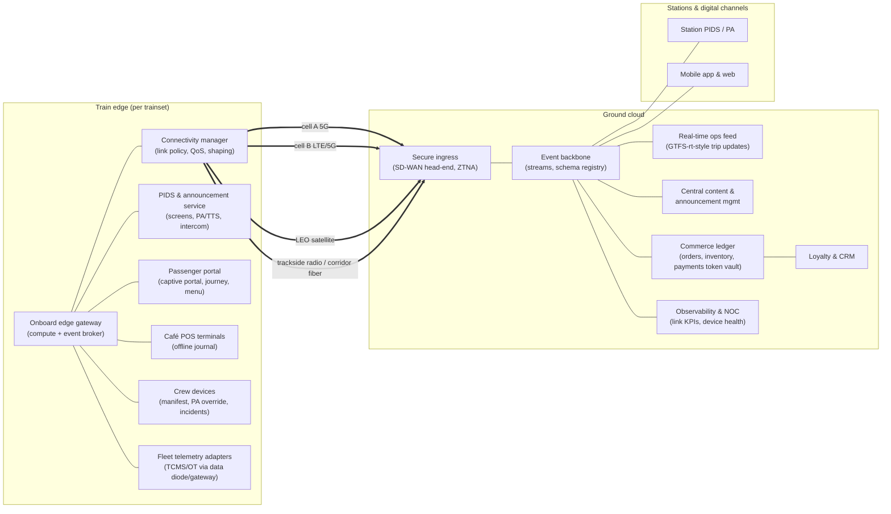
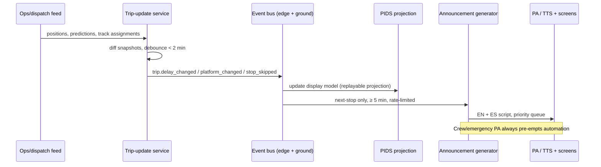
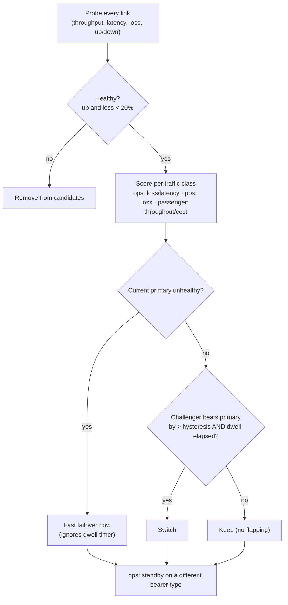
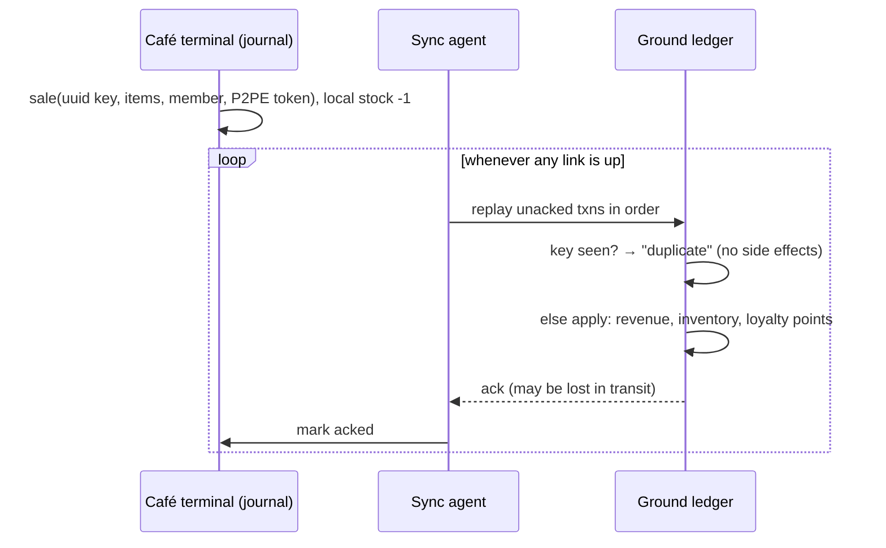

# Rail Passenger Experience Platform — Reference Architecture & Prototype

A train-edge / ground-cloud **reference architecture** for the intercity passenger travel experience, plus a small, tested **Python prototype** of the three hardest onboard problems:

1. **Passenger information**: a real-time feed drives passenger information displays (PIDS) and automated, bilingual announcements.
2. **Onboard connectivity**: a multi-link backhaul policy engine (multi-carrier cellular/5G, LEO satellite, trackside radio on corridor fiber) with per-traffic-class selection, hysteresis and fast failover.
3. **Food & beverage**: an offline-first café POS that keeps selling with no connectivity, then replays transactions idempotently to a ground ledger with inventory and loyalty accrual.

> **Scope and honesty note.** This is a personal reference architecture and working prototype by **Anthony Blow**, built to show how I approach this problem domain. It is not affiliated with any railroad or vendor, has not been deployed in production, and uses only notional data. It applies patterns from my enterprise architecture, edge/IoT and systems-of-systems work to passenger rail.

```bash
make test   # 24 unit tests, standard library only (Python 3.10+)
make demo   # end-to-end simulation of all three subsystems
# or: docker compose up --build
```

---

## 1. Context and goals

Passenger experience spans **stations, digital channels, onboard services and operations**, and those domains usually modernize on different timelines with different vendors. The architecture goal is one target state and a small set of reusable patterns so every new trainset, station or app plugs into the same event, identity, content and connectivity backbone instead of creating another silo.

**Business outcomes the architecture is measured against**
- Passengers always know what is happening: consistent journey status on the app, onboard screens, station signs and audio, including ADA audio-plus-visual parity.
- Usable Wi-Fi along the whole corridor at a controlled cost per GB.
- No lost café sales during coverage gaps; loyalty works offline.
- Lower operating cost through shared platforms, remote monitoring and fewer truck rolls.

## 2. Reference architecture



**Key principle: the train is a disconnected edge site.** Everything a passenger or crew member needs in the next hour (journey state, content, menu, prices, loyalty balances, announcement templates) is cached onboard. The ground cloud is authoritative but never on the critical path for a passenger interaction.

### 2.1 Passenger information flow



### 2.2 Backhaul selection



### 2.3 Offline-first F&B



## 3. Prototype: what the code shows

| Module | Architecture concern | What to look at |
|---|---|---|
| `rpx/feed.py` | Real-time journey data | GTFS-realtime-shaped `TripUpdate`s; snapshot diffing into domain events with debounce |
| `rpx/pids.py` | Passenger information displays | Display state is a pure projection of events, so any screen can rebuild after reboot by replay |
| `rpx/announcements.py` | Automated announcements / PA | Bilingual templates, next-stop-only audio, rate limiting, crew/emergency pre-emption |
| `rpx/backhaul.py` | Passenger Wi-Fi & onboard connectivity | Per-class scoring, hysteresis + dwell, fast failover, bearer-diverse standby for ops traffic |
| `rpx/pos.py` | F&B POS, inventory, loyalty | Append-only journal, client idempotency keys, lost-ACK replay, refunds, loyalty accrual/reversal |
| `rpx/demo.py` | — | One command runs all three on a notional 300 km corridor |

Run `make demo` to see sample output: the PIDS board, the announcement queue, every link switch with its reason and time-on-link per class, and the POS reconciling 4 offline transactions through lost ACKs with exactly-once effects.

## 4. Non-functional requirements

| NFR | Target (notional) | How the architecture meets it |
|---|---|---|
| PIDS availability onboard | 99.95% per trainset, independent of WAN | Local broker + cached schedule; projection rebuild by replay |
| Event-to-screen latency | p95 < 5 s onboard; < 15 s ground-to-train when any link is up | Edge-first pub/sub; small event payloads; ops class gets best link |
| Offline tolerance | 8 h of café sales and full journey info with zero WAN | Durable journal; pre-loaded content, menu, prices, loyalty snapshot |
| Backhaul failover | < 1 probe interval for ops/pos traffic | Fast failover bypasses dwell; hot standby on a diverse bearer |
| Data integrity | Exactly-once business effect for every sale/refund | Idempotency keys + server-side dedupe; ordered replay |
| Accessibility | Audio and visual parity for every automated message | One event drives both PA script and display ticker |
| Observability | Per-link KPIs, per-device health, switch reasons logged | Selector emits structured switch events to NOC |
| Cost | Passenger data steered to lowest cost/GB that meets SLO | Cost term in passenger-class weights; caching; per-session shaping |

## 5. Security architecture

- **Segmentation by trust zone**: separate VLAN/VRF and firewall policy for (1) passenger Wi-Fi, (2) crew and enterprise apps, (3) payments (PCI scope minimized), and (4) train control/OT. OT telemetry leaves through a one-way gateway or data diode pattern; nothing on the passenger network can route toward OT.
- **Zero trust**: every service and device has a workload identity (mTLS, short-lived certificates); crew devices use ZTNA with device posture, not flat VPN access; least-privilege policies per topic on the event bus.
- **Payments**: point-to-point encryption at the reader; the terminal stores only tokens; offline authorization limits and floor limits are set by policy; the ground token vault is the only place card data is detokenized.
- **Passenger privacy**: captive portal with minimal data, consent-based loyalty linking, client isolation on Wi-Fi, DNS filtering, retention limits.
- **Supply chain and fleet hygiene**: signed images for edge workloads, remote attestation, staged OTA updates by trainset cohort with automatic rollback.
- **Standards to align with**: NIST CSF 2.0 and SP 800-207 (zero trust), IEC 62443 zoning for OT, PCI DSS for payments, and the public-transportation cybersecurity requirements that apply to the operator.

## 6. Architecture decision records

| ADR | Decision |
|---|---|
| [0001](docs/adr/0001-edge-first-event-driven.md) | Edge-first, event-driven onboard platform; ground cloud authoritative but off the critical path |
| [0002](docs/adr/0002-backhaul-policy.md) | Policy-based multi-link backhaul with per-class scoring, hysteresis and fast failover |
| [0003](docs/adr/0003-pids-as-projection.md) | PIDS and announcements as projections of one event stream |
| [0004](docs/adr/0004-pos-offline-sync.md) | Offline-first POS with client idempotency keys and server dedupe |
| [0005](docs/adr/0005-network-segmentation.md) | Four trust zones with one-way OT egress and zero-trust service identity |

## 7. Cost and ROI framing

The architecture is justified on a portfolio basis, not per gadget:

- **Reuse**: one onboard gateway, event backbone, content system and identity layer serve PIDS, Wi-Fi, POS and crew apps, so each new capability is a configuration, not a new integration program.
- **Backhaul spend**: steering bulk passenger traffic to the lowest-cost healthy link, plus onboard caching, lowers cost per GB while keeping ops traffic on the most reliable bearer. The prototype logs time-on-link per class so a NOC can price the mix.
- **Revenue protection**: offline-first POS removes "cash only / card reader down" losses during coverage gaps and keeps loyalty earning continuous, which supports attach rate and repeat ridership.
- **Opex**: remote device health and staged OTA updates reduce depot visits and truck rolls; projection-based displays recover themselves after reboots.
- **Measures**: passenger information accuracy (screen vs. ops truth), Wi-Fi session success and throughput per km, cost per GB, café sales captured offline, loyalty enrollment rate, mean time to restore onboard services.

## 8. Phased roadmap

| Phase | Horizon | Outcomes |
|---|---|---|
| 0. Baseline | 0–3 months | Current-state inventory across fleets/stations; target-state principles; event and data contracts; security zoning standard |
| 1. Information first | 3–9 months | Shared trip-update events feeding app, station signs and onboard PIDS on one pilot route; announcement templates centrally managed |
| 2. Connectivity policy | 6–12 months | Policy-based link management with per-class SLOs and cost telemetry on a pilot fleet; satellite/cellular/trackside mix evaluated with data |
| 3. Commerce | 9–15 months | Offline-first POS and mobile ordering on the shared gateway; loyalty accrual reconciled through the ledger |
| 4. Scale & optimize | 12–24 months | Fleet-wide rollout by cohort; predictive maintenance signals from onboard device health; reuse patterns published as architecture standards |

## 9. Repository layout

```
rpx/              prototype package (standard library only)
tests/            unittest suite (24 tests)
docs/adr/         architecture decision records
Makefile          make test | make demo
Dockerfile, docker-compose.yml
```

## Author

**Anthony Blow** — enterprise and solutions architect (edge, IoT, systems of systems, cybersecurity), MS International Transportation Management. Reference architecture and prototype; feedback welcome via issues.

License: MIT
